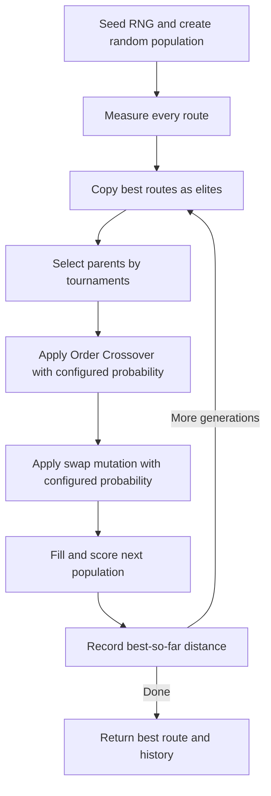

# Phase 2 notes for viva: Standard Genetic Algorithm

## Idea and objective

A Genetic Algorithm (GA) searches by keeping many possible answers, choosing promising ones, combining them, and occasionally changing them. TSP has many possible delivery orders, so a GA can explore routes without checking every permutation. It is a heuristic: it may find a short route but cannot guarantee the global shortest route.

One **chromosome** is a route such as `[0, 2, 1, 3]`; `0` is the warehouse and is fixed. A **population** is a list of chromosomes. The objective score is the complete round-trip distance:

`D(route) = d(0, first) + ... + d(last, 0)`

Smaller `D` is better. For example, distances `0→1 = 3`, `1→2 = 4`, and `2→0 = 5` give route `[0, 1, 2]` a score of `12` synthetic units. The Phase 1 function performs this calculation, including the return trip.

## Workflow

**Tournament selection** samples distinct population positions and chooses the one with the smallest distance. A route can win one tournament and lose another, retaining randomness. Equal scores are resolved by the earlier population index.

**Order Crossover (OX)** copies a consecutive segment of Parent 1's delivery sequence. Starting after that segment, it reads Parent 2 in circular order and fills unused positions, skipping already present IDs. For example, Parent 1 deliveries `[1, 2, 3, 4]`, Parent 2 deliveries `[4, 3, 2, 1]`, and a copied middle segment `[2, 3]` produce a valid ordering containing each ID once. The warehouse is added back at the front. OX works only on the delivery portion.

**Swap mutation** exchanges two distinct delivery positions. For `[0, 1, 2, 3]`, swapping positions 1 and 3 gives `[0, 3, 2, 1]`. With one delivery, no swap is possible and a copy is returned. The mutation rate is checked once for each newly created offspring.

**Elitism** copies the shortest `elitism_count` chromosomes unchanged into each new generation. It prevents the best-so-far distance from increasing. **Convergence history** records that distance before evolution and after every generation; a flat part means no improvement during those generations.

## Parameters and reproducibility

| Parameter | Default | Meaning |
| --- | ---: | --- |
| `population_size` | 100 | Routes kept per generation; larger values explore more but cost more time and memory. |
| `generations` | 200 | Number of evolution steps; more steps allow more search. |
| `crossover_rate` | 0.9 | Probability that each offspring is made with OX; otherwise copy Parent 1. |
| `mutation_rate` | 0.2 | Probability that each offspring undergoes one swap. |
| `tournament_size` | 3 | Number sampled for parent choice; larger values favor shorter routes more strongly. |
| `elitism_count` | 2 | Best routes copied unchanged per generation. |
| `seed` | 42 | Initializes an independent RNG; the same seed and settings repeat route and history. |

The seed helps debugging and fair comparisons. Execution time may differ between identical runs because it depends on the computer's load. Different seeds can reach the same final route.

## Cost and limitations

For `P` routes, `G` generations, and `N` locations, route scoring is `O(N)` after matrix validation; the existing Phase 1 score function also checks the whole `N × N` matrix for each route, so the current implementation is approximately `O(G × P × N²)` time. The distance matrix uses `O(N²)` space; population routes use `O(P × N)` and convergence history uses `O(G)`. This is acceptable for the educational 20-location dataset. The coordinates and distances are synthetic, and GA parameters are demonstration defaults. Phase 3 will add 2-Opt local search.
